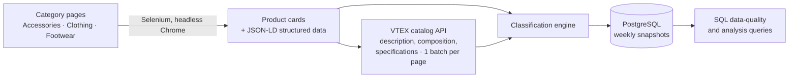

# Colloky Pricing Intelligence

**Automated competitive-intelligence pipeline for a Chilean kids' fashion e-commerce store.** 
It scrapes the full public catalog of [colloky.cl](...), enriches every product with an automatic classification, and stores time-stamped snapshots in PostgreSQL so prices, markdowns, stock and assortment can be tracked week over week.
**Includes a 4-page Power BI dashboard** built for commercial and marketing teams, with data captured hourly during Chile's Cyber Day (October 2026).


`Python` · `Selenium` · `BeautifulSoup` · `PostgreSQL` · `SQLAlchemy` · `Regex / NLP-style text classification` · `Data quality profiling`

---

## Business questions it answers

- How deep and how frequent are the markdowns? Which discount tiers does the brand use (20%, 30%, 40%, 50%, 60%...)?
- Which products are selling out? (share of sizes out of stock per product, and how it changes between weeks)
- How is the assortment split by product type, gender, age segment, material and licensed characters (Disney, Marvel)?
- Which products does the store promote? (position on the page and rank within the category)
- How does a single product evolve over time: price, discount, stock and visibility?

## Key insights

> Based on snapshots captured during Cyber Day, October 2026. Prices in Chilean pesos (CLP).

1. **The whole catalog is on sale.** ~94% of products were discounted; 62% sat in the 41–60% band.
2. **Winter is being cleared.** Beanies, parkas and boots carried the deepest markdowns (54–60% off), often with half their sizes already sold out: end-of-season clearance of broken size runs.
3. **Older stock is discounted hardest.** Using SKU number as a proxy for product age, the oldest items had the deepest discounts, while baby products held their price best.
4. **Prices were stable during Cyber Day.** Footwear held at ~48% off throughout the event; clothing and accessories eased slightly (~45% → ~44%).
5. **Shoppers bought summer.** Discounts targeted winter, but the fastest sell-through came from warm-weather items (shorts, sandals, light tops) and a Halloween costume.
6. **Licensed characters are a small, premium niche.** ~3% of the catalog, priced above own brand (Mickey, Toy Story, Cars at ~CLP 14K vs ~CLP 11.6K) and discounted ~10 pts less in clothing and accessories.
7. **Value positioning.** 9 in 10 products sell for under CLP 20K; footwear effectively sells at half its list price.
8. **Assortment skews female.** Girls' products outnumber boys' ~1.5 to 1 in every age group.

**Caveats.** The licensed premium includes a product-mix effect (licensed items cluster in certain product types). Groups with fewer than 30 SKUs are excluded from rankings to avoid small-sample bias.

## How it works



1. **Crawl.** Walks every page of the three store categories with Selenium (headless Chrome) and stops by itself at the end of the catalog.
2. **Extract.** Combines what the product card shows (selling price, list price, image) with the page's JSON-LD (SKU, per-size offers and availability).
3. **Enrich.** For each page, one batched call to the store's public VTEX catalog API brings the product description, the *Composition* specification and the description sections (*Care tips*, *When to wear it*, *Pairs well with*).
4. **Classify.** A rule-based text engine turns free-text product names into structured attributes (see below).
5. **Load.** Upserts into PostgreSQL keyed on `(product_url, date_scraped)`: every run is a new snapshot and history is never overwritten.

## Classification engine

Product names are free text written by the brand, with typos and inconsistent formats, e.g.
`"Pijama algodón Marvel Spiderman niño rojo 2A a 12A"` or `"Pack 3 grises Calcetines"`.

| Attribute | Approach |
|---|---|
| **Product type** (100+ types) | Keyword dictionary where the *earliest* keyword in the name wins (longest on ties); special handling for *Pack* and *Set* products |
| **Typos** | Explicit typo map + strict fuzzy matching (`difflib`, similarity ≥ 0.80 with protected words) |
| **Gender** | Girl / Boy / Unisex from the name |
| **Age segment** | Parses size ranges (`6/9M a 4/5A`, `RN`, `3 a 36 meses`) and EU shoe sizes (14-17 Baby, 18-27 Toddler, 28+ Kids) |
| **Licensed characters** | Disney / Marvel characters, with a fallback to the generic franchise |
| **Material** | Priority: 1) the product's *Composition* specification (e.g. "98% Algodón, 2% Elastano"), 2) name + description, ignoring ambiguous words ("combine it with your jeans" is not denim) |
| **Color** | Plurals, shades ("azul marino", "rosa viejo"), multicolor/bicolor detection |

A built-in test table runs before every scrape to check the classifier on known edge cases.

## Dashboard (Power BI)

| Page | Focus |
|---|---|
| **Overview** | KPIs, assortment split, discount depth, trend, audience (age × gender) |
| **Pricing & Discounts** | Discount vs. stock-out scatter, heatmap by product and age, list vs. selling price, price tiers, Cyber Day trend |
| **Licensing & Marketing** | Licensed price premium, character mix, licensed vs. own-brand discounting, top colors |
| **Top Products** | Fastest selling-out products and biggest shopper savings, with product photos |

| | |
|---|---|
|  |  |
|  | |

### Modeling highlights

- **Snapshot-aware DAX.** Every measure evaluates the latest snapshot in the current filter context, so KPIs never double-count products across runs and time-series visuals use each run's own data.
- **Sell-through proxy.** `Stockout Increase` compares each product's stock-out rate against its first snapshot, which approximates sales velocity without access to sales data.
- **Minimum-sample measures.** Ranking measures return blank for groups under 30 SKUs, so Top-N lists aren't distorted by tiny groups.
- **Power Query.** Discount buckets, price tiers, custom sort keys and one image per product (de-duplicated by product URL).
- **Brand theme.** Custom JSON theme based on the brand's navy, with consistent character colors across visuals.

## Data model

One row per product per snapshot (`colloky_prueba_f`):

| Group | Columns |
|---|---|
| Snapshot & identity | `date_scraped`, `brand`, `category`, `sku`, `product_url`, `image_url` |
| Merchandising | `page_number`, `page_position`, `category_rank` |
| Classification | `product_type`, `gender`, `age_segment`, `age_min_months`, `size_range`, `is_licensed`, `license_brand`, `license_character`, `color`, `color_type`, `color_count` |
| Material | `material`, `material_source`, `material_composition` |
| Content | `product_description`, `description_main`, `care_tips`, `when_to_use`, `pairs_with` |
| Pricing | `original_price`, `final_price`, `discount` |
| Stock | `offers_total`, `offers_in_stock`, `offers_out_of_stock`, `stockout_rate` |

## Data quality

Data quality was treated as part of the product, not an afterthought. `colloky_data_quality.sql` profiles every column generically (it unpivots each row to JSON, so new columns are covered automatically) and separates **real NULLs**, **blanks** and **placeholder values** such as `"Not Specified"`, which a plain NULL count would miss.

Profiling the first runs drove concrete design decisions:

- **Dead columns removed.** Two size-level columns were 100% empty because the listing pages do not expose size labels, so they were dropped.
- **Material coverage.** Material was unknown for ~77% of products when inferred only from names, so the product *Composition* specification was added as the primary source.
- **Partial content explained, not deleted.** The rich description sections exist for only ~26% of products, and all three sections are missing on exactly the same products. That pattern points to content the brand wrote only for part of the catalog, not to a scraping failure. A dedicated query tests that hypothesis.
- **Consistency checks.** Price vs. list price, discount math, stock counts, licensing flags, duplicate SKUs.

First full run: **3,387 products** across 3 categories and 114 pages, with no failed pages.

## Reliability features

- **Retries.** Every page gets 3 attempts and Chrome is restarted between attempts.
- **Unattended runs.** Headless Chrome; the computer is kept awake during the run (Windows, macOS, Linux); everything is logged to `logs/`.
- **Resumable snapshots.** An interrupted run continues where it stopped, without duplicating rows.
- **Duplicate SKUs.** If the catalog reorders mid-run and a SKU appears twice, the occurrence with **less stock** is kept, since it is the most recent and most conservative reading.
- **Polite crawling.** Delays between pages, one batched API call per page, public data only.

## Project files

| File | Purpose |
|---|---|
| `colloky_scraper.py` | The scraper (crawl, enrich, classify, load) |
| `colloky_schema.sql` | Table definition; read automatically by the scraper |
| `colloky_data_quality.sql` | Data-quality and analysis queries (profiling, consistency, product zoom, price history) |
| `run_scraper.bat` / `run_scraper.sh` | Background launchers for Windows / macOS-Linux |
| `.env.example` | PostgreSQL environment variables |

## How to run

```bash
pip install -r requirements.txt
```

1. Have PostgreSQL running and set the connection variables listed in `.env.example`.
2. Run `python colloky_scraper.py`, paste it into a Jupyter cell, or double-click `run_scraper.bat` (Windows) to run it in the background.
3. When it finishes, open `colloky_data_quality.sql` in pgAdmin to review data quality and explore the snapshot.

Main settings are at the top of the script: categories, headless mode, sleep prevention, the resume option and whether to fetch descriptions.

## Example analyses

- Discount distribution by category and product type
- Products with the highest share of sizes sold out (proxy for best sellers)
- Licensed vs. own-brand pricing and markdown depth
- A single product's price, discount, stock and visibility over time

## Roadmap

- Schedule the weekly run automatically
- Dashboard on top of the snapshots (price index, markdown calendar, sell-through proxy)
- Week-over-week sell-through estimate from changes in available sizes

---

*Personal portfolio project. It only collects publicly available catalog information at a low request rate and is not affiliated with Colloky.*

---
**Author:** [Constanza Andrea Perez Pulido] · Data Analyst · [LinkedIn](https://www.linkedin.com/in/constanzaperezpulido/)] · Open to remote roles (US/Canada)
